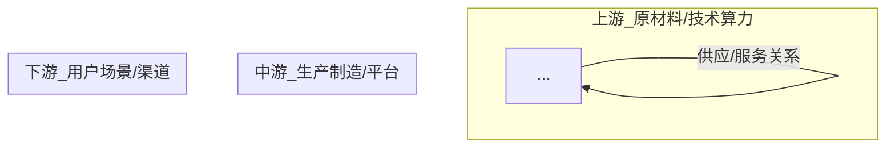

# quant-risk — 零成本 A股+港股 量化选股 Skill

## 项目定位

**零成本 · A股+港股 量化选股 AI Skill**（Claude Code · Codex · ZCode 通用）：给人方便使用，GitHub 下载即用——一行命令 `install_skill.sh` 装为 AI Skill，对话即可推荐标的/分析单股/每日信号/持仓诊断。数据全部来自**免费公开接口**（腾讯/东财/新浪/Yahoo，零注册、零 API Key、零订阅）。覆盖 **A 股 + 港股** 全生命周期风控：投前审查 → 持仓监控 → 预警触发 → 处置决策。脚本可直接 CLI 运行（`uv run scripts/...`），亦可 Docker。

**市场范围（2026-08-31 更新）**：美股已移出维护范围，**主看 A 股 + 港股**。`recommend_us.py`/`--market us` 属 legacy 兼容路径，不再维护、不纳入日常推荐流程。

**分发形态（2026-09-18 用户确认）**：以 Skill 分发为第一顺位（`scripts/install_skill.sh`/`install_skill.ps1`，装到 `~/.claude/skills/quant-risk` 或 `--dest` 指定 Codex/ZCode 目录，AI 首次执行时自动 `uv sync`）；Docker 镜像（GHCR，`--extra semantica` 全量）+ 本地 CLI（`install.sh`/`install.ps1`）为备选。仓库不携带用户本地数据（`data/` 记忆库、`report/` 生成物、`ve.pptx` 均已 gitignore/出库）。

## 核心约定（硬约束 + 指针）

- **🧠 变更即同步铁律**：用户每次对输出格式、模板、评分体系、分析流程提出的更改，**必须立即同步到 AGENTS.md 或对应 `docs/agents/` 主题文件**（swing-system / value-legacy / data-sources），不得延后。这是防止反复犯同样错误的根本措施。
- **Python 包管理**: 用 `uv add` 不用 pip
- **执行 Python**: 用 `uv run`
- **记忆系统**: Hindsight（Agent Memory，MCP 前缀 `mcp__hindsight__`） + OpenKnowledge（文档知识）双轨制（2026-10-12 用户确认：已弃用 AgentMemory/TencentDB，切换为 Hindsight）
- **📄 主题文档索引（细节按需读取，不占常驻上下文）**：
  - `docs/agents/swing-system.md` — **波段系统全部决策细节**（四维评分/道氏/ATR/上车离场/候选池/回测闭环/MCP server/daily 工作流/舆情辅助/三tab简介）。任务涉及波段评分、候选池、回测、MCP、daily 时读取。
  - `docs/agents/value-legacy.md` — **legacy value 模式**（六维评分/四大师/缠论/镜像测试/行业漏斗/产业链Mermaid）。仅 `--mode value`、tech_chan、推荐脚本 formatter 投委会时读取。**portfolio_report.py 已于 2026-09-23 全道氏化（调仓裁决改为道氏信号驱动、投委会辩论已删除），不再属本文件范围。**
  - `docs/agents/data-sources.md` — **数据源优先级完整表**（行情/K线/基本面/资金面源链、限流排查、K线 fallback 链）。涉及数据获取与限流排查时读取。
  - `docs/agents/jev-advice.md` — **TypeSafe jev 外部 AI 裁决**（state/questions 写法、依赖 TYPESAFE_API_KEY、三类结构化问题、踩坑）。任务涉及 jev 模型、持仓买卖双引擎交叉验证、`scripts/jev_advice.py` 时读取。

- **数据分析方法（当前默认）**：A股与港股采用纯技术波段筛选，**持有周期不限定为 1-2 周——可以是几天、1 个月，若是真正的好标的持有 1 年也可**。总分 100 分：日线趋势 30 + 日线量价/资金 25 + 日线道氏 20 + 30 分钟道氏 25。评分只使用行情、成交量、资金和道氏趋势（摆动点）数据——基本面不参与评分与估值比较；但另设**基本面门禁（只否决不加分）**，详见下方「基本面门禁」条与 `docs/agents/swing-system.md`。
- **波段方向判定（2026-09-08 起为道氏理论，替代缠论）**：日线方向用**道氏次级趋势**（摆动点序列判趋势）、30 分钟用**道氏小趋势**确认入场/离场。禁止把周线缠论、日线中枢、基本面评分或旧缠论笔/线段作为默认波段入场依据；30 分钟数据缺失或与日线方向冲突时只能观望。
- **滞后性纪律（必须时刻注意）**：道氏是「事后确认」理论，趋势反转天然滞后——要等价格跌破前低才确认转势。①动能走弱预警（价创新高但 MACD 柱收缩）的上升趋势必须降级处理——严格等回踩支撑介入、绝不追当日涨幅、仓位减半；②高位放量滞涨视为动能衰竭信号；③「回踩支撑企稳再介入」是默认操作而非可选项；④连续多日高位横盘警惕趋势末端。
- **滞后性纪律=扣分+降档双轨（2026-09-24 grill Q7/Q12，升级原纯降档版）**：三条可量化纪律在 `swing_score_one` 代码化——①动能走弱（价创新高 MACD 柱收缩）日线趋势 **-6**；②高位放量滞涨（60日区间≥85%分位 + 量比>2x + 当日涨幅<1%）量价 **-6**；③高位横盘（高位区连续≥10日振幅<4%）日线趋势 **-4**。扣分写回维度分并在 reason 标注 `⚠️XX扣N分`（评分扣分可见），明细进 `result["discipline"]`；状态封顶**谨慎布局**且规则引擎 ALLOW 也压不回"当前可布局"（BLOCK/EXIT 等更严裁决不受影响）；预警不抢道氏转势确认的活——跌破前低才由道氏给离场。
- **基本面门禁（2026-09-24 grill Q1/Q5/Q6/Q11，核心实现 `scripts/quantrisk/gate.py`）**：基本面**只否决不加分**——不进 100 分评分（评分保持纯技术：趋势30/量价25/日线道氏20/30m道氏25）；评分完成后对候选（≤80只/市场）+ 持仓**后置**拉财务评估，不扫全池。A股严：归母净利为负/负债率>70%/营收同比<-20%/ST·退市；港股松：退市风险/负债率>80%；**金融业（名称含 银行/证券/保险/信托）仅豁免负债率规则**（负债=存款/保费是商业模式，净利/营收/ST 规则照常，`notes` 留痕并在报告透出）；财务数据缺失 **fail-open 不否决**（回测归"未评估"，不硬凑分组）。触发即从 TOP10 剔除并渲染 `⛔ 基本面门禁否决：<规则>`，回测记录 `veto` 字段做通过组/否决组对比（Q13 通过线）；**持仓只标"不加仓"，卖出裁决仍完全归道氏 `_dow_verdict()`**；单股分析（analyze_swing.py）同源评估，veto 时状态封顶⛔禁止新建仓。
- **记住：状态必须带触发价，禁止只输出"谨慎布局/观望"不给价格**（详见 swing-system.md 上车/离场条件条目）。

## 📋 输出格式铁律（已固化，直接执行，不必再查知识库）

以下规则经过反复踩坑后固化，是 quant-risk 项目的最高优先级行为规范，所有会话必须遵守。

### ⛔ 规则一：脚本输出原样展示，严禁追加手写内容

- 脚本输出的报告必须**原样展示**，严禁在末尾追加手写表格或自定义分析
- 所有格式统一由脚本的 formatter（`formatter.py` / `formatters/`）控制，改格式只改文件不改输出
- 需要补充分析时，放在脚本输出之后并用 `---` 分隔线隔开，且必须写明"以下为补充说明"

### 📌 规则二：脚本粘贴强制检查（反复踩坑）

执行脚本后，**第一步必须把 Bash/工具返回的脚本完整输出逐字复制到回复正文中**，不能只写"脚本输出完毕"就跳过。

反复出现的错误：模型拿到了工具结果但在 compose 回复时忘了粘贴，直接跳到补充说明。

**写回复前强制自问**：工具返回的每一行内容都贴到正文里了吗？确认后再发送。

### ⛔ 规则三：脚本输出绝不加 ``` 代码块（反复踩坑多次）

脚本输出本身是 markdown（含 `|` 表格），**直接粘贴到回复正文**，绝不能包在 ``` 代码块里——加了代码块表格就会变成纯文本，渲染不出来。

**写回复前强制自检**：
- 脚本输出有没有被包在 ``` 里？→ 如果有，去掉！
- 表格行有没有 `|` 分隔符？→ 应该有，在正文中直接渲染

### 🏷️ 规则四：LLM 补充分析必须标注数据来源

在 `---` 分隔线之后的"补充说明"中，**必须标明每条信息来源**。读者必须能区分哪些是原始数据、哪些是 LLM 的二次解读、哪些是外部检索补充的内容。

| 数据来源 | 标注格式 | 适用场景 |
|---------|---------|---------|
| 基于脚本输出的解读 | `> 📡 数据来源: 基于脚本输出解读` | 对四张表的数字做趋势判断、对比分析 |
| wigolo 联网检索（可溯源） | `> 📡 数据来源: wigolo [URL]` | 补充市占率、研报评级、行业景气度等脚本之外的数据 |
| 多源混合 | 每条内容单独标注 | 脚本输出 + wigolo 拼在一起写 |

**正确示例**：
```
---

## 以下为补充说明

> 📡 数据来源: 基于脚本输出解读

**技术面判断**：RSI14 仅 38.94，说明反弹动能不足；布林中轨 70.37 是短期压力位。

> 📡 数据来源: wigolo [https://www.xxx.com/report]

**行业背景**：MDI 价格处于近3年40%分位，行业景气度回暖。
```

### ✅ 规则五：脚本输出展示标准流程（反复踩坑后固化）

脚本输出必须通过 **文件落地 + Read 工具读取** 的方式展示，**禁止依赖 Bash 工具返回的 stdout 直接粘贴**（Bash 输出在某些视图下不可见）。

标准三步流程（**新会话也必须遵守，不可跳过**）：

1. **执行落地**：`uv run scripts/analyze.py <code> > /tmp/report.md 2>&1`
2. **Read 展示**：用 Read 工具读取 `/tmp/report.md` 显示完整内容
3. **补充说明**：在 `---` 分隔线后追加 LLM 补充说明

### 🔍 规则六：外部数据验证铁律（2026-07-17 新增）

**严禁用训练记忆数据充当事实输出。** 股票分析和推荐涉及外部事实性数据时，必须通过联网验证。

**适用范围**：
- 行业市占率、产能数据、全球排名
- 券商研报目标价、评级、盈利预测
- 财务指标的具体数值（季度营收/净利/ROE 等）
- 行业景气度、价格分位、供需平衡
- 公司战略、业务结构、技术壁垒等定性描述

**执行规则**：
1. **脚本输出**（analyze.py / recommend.py）→ 原样展示，不受影响
2. **补充说明中的事实性数据** → 必须用 wigolo 或 extract 验证后再写，且每条数据必须标注来源 URL
3. **某数据无法验证** → 明确标注"数据待验证，来源未确认"，严禁凭空填写
4. **仅凭逻辑推断的合理结论**（如"PE 偏低说明估值修复空间"）→ 可以写，因为这是分析方法不是事实数据

### ⚡ 规则七：输出风格偏好（2026-07-23 用户明确）

**这是硬性行为规范，每次输出必须遵守。**

| 偏好 | 说明 | 禁止的写法 | 正确的写法 |
|------|------|-----------|-----------|
| **强制给结论** | 每项分析必须给明确结论，不能含糊 | "可适当关注""值得关注" | 🔴止损 / 🟢买入 / 🟡持有 / 🟢加仓 |
| **不怕冲突** | 大师视角对抗要尖锐，质疑和答辩要直接冲突 | "各有道理""双方都有可取之处" | 一方明确驳斥另一方，给出明确胜负 |
| **数据诚实** | 缺失数据直接说"数据缺失"，不要胡编 | "无数据""暂无""—" | **数据缺失** |

**核心原则**：
- 不要怕和 LLM 吵架，用户就想看 LLM 吵架
- 如果缺失数据，就说"数据缺失"，不要编造"暂无"、"—"等模糊占位符
- 每项分析必须给可操作的结论（买/卖/持有/止损），不能只给"可关注"

**评分扣分可见（2026-07-23 新增）**：六维评分表中，若维度因大师质疑被扣分，评分列显示 `X.X/10 ↓-0.5`，扣分原因追加到大师视角列（`⚠️ 扣分原因：...`）。大师答疑列以 `✅质疑成立，评分已扣减` 或 `❌质疑不成立，评分不受影响` 开头，给出明确结论。

### 📐 规则八：结论先行、论据随后、数据溯源（2026-08-05 用户明确）

**这是硬性展示模板，每次输出分析必须遵守。**

展示结构（任何分析报告、个股点评、推荐回复统一采用）：

1. **结论先行**：第一屏先给操作结论（🟢买入 / 🟡持有 / 🔴止损 / 观望 + 仓位 + 一句话理由），禁止把结论埋在数据后面
2. **论据随后**：结论之后按「基本面 → 技术面 → 热点/情绪」顺序展开支撑论据，每个论据给明确方向（支持/反对当前结论）
3. **数据带溯源**：每个引用数据的论据行必须标注来源，格式 `> 📡 数据来源: ...`，脚本输出标注 `基于脚本输出解读`，外部检索标注 URL；禁止出现无来源的数字

**正确示例**：
```
**结论**：🟡 持有（10-20% 仓位）— 短期反弹到压力位，中线未反转，回踩企稳再补。

**论据一 · 基本面**（支撑持有）
- 营收 -11.8%、净利 +342.9%（主要靠投资收益）→ 主业弱，不构成买入理由
> 📡 数据来源: 东财 datacenter（脚本输出）

**论据二 · 技术面**（支撑持有/观望）
- 价格触及布林上轨 23.39，RSI 63，短线追高性价比低
> 📡 数据来源: 基于脚本输出解读
```

**禁止的写法**：先铺一大段表格/数据再给结论；引用数字但不标来源；结论含糊（"可适当关注"）。

**缠论必须给结论（2026-08-05 用户明确）**：缠论部分禁止只罗列「笔↓ / 中枢区间 / 价格位置」数据，必须输出一句话结论，包含三要素：
1. **方向**：🟢偏多 / 🟡中性 / 🔴偏空（含评分）
2. **买卖点**：当前有没有一/二/三类买卖点或背驰信号；无则明确写"当前无买卖点信号，等待背驰或突破确认"
3. **操作含义**：把缠论结论翻译成可操作语言（等回踩 / 等突破 / 观望 / 警惕三卖）

示例：`缠论结论：🟡 中性（评分 -2）| 单中枢盘整（偏空）| 当前无买卖点信号，等待背驰或突破确认 → 操作：观望，等回踩中枢下沿或放量突破再介入`

### 📊 规则九：表格报告必须含买卖价格与逻辑（2026-08-31 用户明确）

**这是硬性展示规范，每次出表格推荐报告必须遵守。**

凡输出标的表格（推荐清单、调仓路线图、执行计划等），每只标的**必须同时给出价格与逻辑两栏，缺一不可**：

| 必含字段 | 说明 | 禁止的写法 |
|---------|------|-----------|
| **买入价/区间** | 具体数字或区间，注明"现价追"/"回踩X企稳"/"突破X介入" | "逢低买入""择机介入" |
| **卖出价/目标** | 具体数字，附涨幅预期 | "看到上方""压力位附近" |
| **止损价** | 具体数字，附跌幅 | "设好止损" |
| **买入逻辑** | 一句话讲清为什么买（资金/量价/缠论/舆情/板块） | 只写评分不写理由 |
| **卖出逻辑** | 一句话讲清什么条件下离场（到价/破位/缩量滞涨/逻辑证伪） | "动态调整" |

**正确示例**：

| 标的 | 买入 | 止损 | 目标 | 买入逻辑 | 卖出逻辑 |
|:----|:----|:----|:----|:----|:----|
| 诺德股份 600110 | 回踩11.5企稳介入（勿追12.03） | 11.07(-8%) | 13.23(+10%) | 主力5日+6.88亿名单最大+量比1.20量价齐升+锂电铜箔/AI服务器HVLP题材 | 到13.23止盈或跌破11.07无条件离场；持仓3日缩量滞涨减仓 |

**禁止**：只给"🟢买入"结论却不给价格；只给价格却不给为什么买/为什么卖；用"逢低""择机""动态"等不含数字的模糊词。

## 用户持仓读取顺序

当需要获取用户持仓信息时，按以下优先级依次查找，找到即停：

1. **当前会话上下文** — 用户在本轮对话中已提及的持仓
2. **Hindsight** — 通过 `mcp__hindsight__recall` 查询关键词 `portfolio` / `持仓` / `holding` / `02460`，**迁移与用法详见知识库** `/Users/xiazhicheng/project/llm_wiki/articles/dsh-mcp-hindsight-migration.md`
3. **询问用户** — 以上均无数据时，要求用户自行提供持仓信息

> 🗂️ **持仓数据仅存储在 Hindsight 中，不保存本地文件**，不再有 `portfolio.json`。
> `portfolio_report.py` 通过 `--stdin` 参数接收持仓 JSON，AI 从 Hindsight 取出后通过管道传入。


## 用户持仓自动保存规则

**触发时机**（满足任一即执行保存）：

1. **用户主动提供或更新持仓信息时** — 用户明确说出"我的持仓是..."、"买入/卖出了XX"等
2. **持仓诊断/风控分析完成后** — 分析结果涉及持仓变动建议时
3. **会话结束时** — 本会话中持仓信息发生过变更

**保存操作（写入 Hindsight）：**

通过 `mcp__hindsight__sync_retain`（同步写入，read-after-write 立即可查；异步用 `mcp__hindsight__retain`），参数：
   - `content`: 完整的持仓 JSON 内容（账户总览 + 各标的明细）
   - `context`: `"preference"`
   - `tags`: `["portfolio", "持仓", user_name, ...]`

**注意：** 不要等待用户说"保存"才执行。上述触发时机到来时，自动执行保存。


## 🚀 一句话投资建议工作流（2026-07-24 更新）

用户只需说 **"给我投资建议"**（或类似的一句话），自动触发完整分析流程：

**步骤 1 — 获取持仓**
- 按「用户持仓读取顺序」查找持仓
- 有持仓 → 跳转步骤 2
- 无持仓 → 请用户手动输入或上传截图

**步骤 2 — 获取最新行情**
- 调用 `hk_stock_quote_tencent_async` 获取各标的最新价（无需更新本地文件）

**步骤 3 — 宏观环境联网检索（LLM 执行）**
- 使用 `wigolo` 查询当前宏观环境（每条数据必须标注来源 URL）：
  - 关键词示例：`"港股 2026年7月 市场走势"`、`"美联储 利率 最新"`、`"中东局势 原油"`、`"金十数据 宏观要闻"`
- 关注要点：美联储利率政策、地缘政治风险（中东/俄乌）、中国经济数据、港股资金流向、板块轮动
- 将宏观分析结论作为报告的**第一部分**，为后续组合诊断提供背景

**步骤 4 — 运行组合完整报告**
- 从 Hindsight 取出持仓 JSON，通过 stdin 传入：
  `echo '{"holdings":[...]}' | uv run scripts/portfolio_report.py --stdin`
- 输出报告保存到 `report/` 目录

**步骤 5 — 运行新标的推荐**
- `uv run scripts/recommend.py`
- 输出 TOP10 推荐标的 + 定价择时
- 输出报告保存到 `report/` 目录

**步骤 6 — LLM 综合分析（关键步骤）**
- **禁止直接粘贴脚本输出**——LLM 必须：
  1. 结合步骤 3 的宏观环境，解读每只持仓和推荐标的风险收益
  2. 结合外部宏观环境，判断脚本给出的道氏持仓裁决（离场/减半/持有观察/持有）是否需要调整，调整意见必须标注为「LLM 补充意见」
  3. 使用 wigolo 补充特定标的外部信息（如行业新闻、竞对动态、政策变化），每条数据必须标注来源 URL
- 输出格式：宏观环境 → 调仓路线图 → 组合总览 → 持仓诊断（含委员会主席宏观点评）→ 换仓建议（含委员会主席宏观点评）→ 执行计划

**输出格式铁律：**
- 脚本输出的报告**不直接粘贴**，而是由 LLM 解读后重新组织
- 所有宏观数据必须标注来源（`> 📡 来源: wigolo [URL]`）
- LLM 补充分析与脚本输出之间用 `---` 分隔

---

### 📋 投资建议报告（固定模板）

#### 第一部分：调仓路线图（结论先行）

**调仓路线图 Mermaid 图**（道氏裁决驱动的卖出端：清仓/减半 → T+2到账 → 买入端自动取自当日 recommend 报告 TOP2，已跳过「观望」，不硬编码）

**组合总览**

| 指标 | 值 |
|:----|:---|
| 总投入 | XXXX HKD |
| 当前市值 | XXXX HKD |
| 总盈亏 | XX.XX%（XXXX HKD）|
| 持仓数 | X 只 |
| 集中度 TOP1 | 名称 XX.XX% ⚠️（超/未超50%红线）|
| 组合健康度 | ★★☆☆☆ X.X/5 |

**各股分析（逐只）**

按以下结构逐只输出，**不含六维评分表、行业漏斗、镜子测试、投委会辩论（均已取消）**；调仓裁决只由道氏信号决定（`portfolio_report.py` 的 `_dow_verdict()`）。

-----

**标的名称**（代码）— 成本 X.XX → 现价 X.XX | 盈亏 -X.XX%（-XXX HKD）| 仓位 XX.XX%

**公司概况**
- 🏢 **主营业务**: ...
- 👤 CEO: ... | 📍 ... | 👥 ...
- 📅 ...年成立 | 📊 ...年上市
- 📡 数据来源: ...

**🔧 产业链全景图**


> 卡脖子: 关键制约因素
> 竞品对标: 与行业龙头差距

**核心财务数据**（Mermaid 流程图展示营收增速/净利增速/ROE/毛利率/负债率/PE，🟢🔴🟡标记）

**🔧 技术面分析**

**① 周线大势**

| 指标 | 数据 |
|:----|:----|
| MA60 | XX.XX，偏离+X.XX% 🔴偏空/🟢偏多 |
| 道氏判定 | 上升/下降/震荡，摆动点N |

**② 日线走势**

| 指标 | 数据 |
|:----|:----|
| 走势类型 | 最近日线趋势 up/down/neutral（收盘价摆动点）|
| 道氏结论 | 🟢上升趋势/🟡震荡/🔴下降趋势，状态+边界（跌破前低X转空、突破前高Y延续），必须含操作含义 |
| 最近摆动点 | ↑/↓/➖ YYYY-MM-DD~YYYY-MM-DD [低X→高Y] |
| 趋势健康 | 上涨放量/缩量（量比X）|
| 三阶段 | 吸筹/公众参与/派发 |

**③ 关键信号**

| 维度 | 信号 | 数值 |
|:----|:----|:----:|
| MA排列 | 偏多/偏空/中性 | MA5=XX MA10=XX MA20=XX MA60=XX |
| MACD | 多头✅/空头❌ | DIF=XX DEA=XX 柱=XX |
| 动能预警 | ⚠️动能走弱/✅动能转强/无 | MACD 柱背离（价新高柱收缩）|
| 风控 | 止损-X.XX% | 止损 XX.XX / 卖出：移动止盈（跌破前低X或自高点回撤X%离场）|

**🔥 市场情绪**（Mermaid journey 图，10分制，价格40%+量能30%+趋势30%）

**🎯 道氏持仓裁决**（方向/边界/量能/裁决/触发价 — 由 `_dow_verdict()` 生成，**基本面不参与调仓裁决**）

**操作建议**: 🔴离场 / 🟡减半 / 🟡持有观察 / 🟡持有 / 🟢持有

-----

（第二只标的重复相同结构）

---

#### 第二部分：关键提醒

- 各标的操作提醒（为什么这么操作）
- 🌍 宏观环境（联网检索，作为调仓决策的背景补充，每条数据标注来源 URL）

---

> 📡 数据来源: scripts/portfolio_report.py + scripts/recommend.py 输出
> ⚠️ 声明：基于公开市场数据，不构成投资建议

---

**模板使用铁律**：
1. 每部分标题、表格列名、顺序**完全一致**，不能增删改列
2. 表格内容填脚本输出的实际值，没有值写"暂无"
3. 无持仓需要诊断时跳过第一部分，直接输出"当前无持仓"
4. 无可换仓资金时，推荐表格位置写"无可释放资金，当前无换仓需求"
5. 补充说明可以追加在 `---` 分隔线之后

- 保存本次持仓信息到 Hindsight（`mcp__hindsight__sync_retain`，`context="preference"`，`tags=["portfolio","持仓",...]`）


## 架构速览 (V1.20.0)

所有代码统一在 `scripts/` 目录下，`quantrisk` 作为 `scripts/quantrisk/` 子包存在。

```
scripts/
├── analyze.py               统一多市场分析脚本
├── analyze_swing.py         单股波段分析（A股/港股，复用 swing 评分核心）🎯
├── backtest_rotation.py     市场轮动策略回测 CLI（A股中证500/港股成交额Top100）🎯
├── backtest_multifactor.py  多因子策略回测 CLI（趋势55/波动25/成交额20+择时+止损止盈）🎯
├── backtest_trendgate.py    闸门动量回测 CLI（rotation × 沪深300 MA20 择时闸门）🎯
├── pit_check.py             Point-in-Time 池检验（量化"当前池快照"前视偏差）🎯
├── backtest_grid.py         网格交易回测 CLI（宽基 ETF 等比网格）🎯
├── backtest_dualengine.py   双引擎组合回测 CLI（趋势 TrendGate × 震荡 Grid）🎯
├── analyze_fit.py           策略适配性诊断 CLI（单股：适合网格还是趋势）🎯
├── backtest_adaptive.py     自适应切换回测 CLI（检验"先判定再切换"是否成立）🎯
├── daily_run.py             每日收盘工作流（Phase 1，无 LLM 依赖）🎯
├── recommend.py             统一推荐脚本入口
├── portfolio.py             持仓诊断工具
├── portfolio_report.py      持仓完整报告（道氏调仓裁决+产业链背景+道氏技术面+情绪面）🔥
├── jev_advice.py            TypeSafe jev 外部模型持仓买卖裁决（state/questions 见 docs/agents/jev-advice.md）🎯
├── tech_chan.py             缠论深度分析 + 产业链Mermaid输出 🔥
├── chan_mtf.py              缠论多周期联立分析
├── formatter.py             选股推荐格式化器 (Pydantic + 渲染)
├── formatters/              四阶段风控格式化器（_pretrade/_holding/_alert/_disposal）
├── mcp_server.py            MCP server（stdio + Streamable HTTP 双 transport，5 工具）
└── quantrisk/               Python 模块（scripts/quantrisk 子包）
    ├── data.py              数据层 — 行情/K线/基本面/资金面/信号/公告 + TickFlow
    ├── daily.py             每日编排：run_daily + render_daily_summary
    ├── chan.py              缠论 — 分型→笔→线段→中枢→背驰→买卖点
    ├── indicators.py        技术指标 — MA/MACD/RSI/KDJ/BOLL + 缠论 re-export
    ├── rotation.py          市场轮动策略核心（成分池/得分/选股/回测引擎）🎯
    ├── multifactor.py       多因子策略核心（硬过滤/三因子/波动档位/择时/止损止盈）🎯
    ├── trendgate.py         闸门动量核心（rotation 选股 × MA20 闸门 + 敞口/确认日数）🎯
    ├── grid.py              网格交易核心（等比网格/逆向低买高卖/费率敏感）🎯
    ├── dualengine.py        双引擎组合核心（资金分层加权/再平衡/相关性/权重扫描）🎯
    ├── fit.py               策略适配性诊断核心（IR 趋势强度/ER 曲折度/一手门槛）🎯
    ├── adaptive.py          自适应切换核心（滚动判定/预测力检验/收益拼接）🎯
    ├── screener.py          标的池筛选 + 批量查询
    ├── report.py            StockAnalyzer 一键全量分析入口
    ├── recommender.py       共享过滤/评分引擎
    ├── recommend_cn.py      A股选股推荐适配器
    ├── recommend_hk.py      港股选股推荐适配器
    ├── recommend_us.py      美股选股推荐适配器（legacy）
    └── chain_renderer.py    产业链渲染器：Mermaid 图文本生成
```

## 🎯 两市场推荐配置（2026-10-09 用户确认，全部研究后的最终结论；**2026-10-13 A股档位更新**）

| 市场 | 策略 | 理由 | 入口 |
|:--|:--|:--|:--|
| **A股** | 🟢 **TrendGate（闸门动量）激进档** | 2026-10-13 用户选定 **MA30 激进档**（回撤预算 ≤20% 达标：-17.9%）。最新数据端点（2026-10-13）复现：**+197.94% / 年化 46.9% / 回撤 -17.92% / 夏普 1.813**（跑赢同池等权基准 +171.64pp）；gma 10→20→30 单调递增（1.15→1.66→1.84）非孤点拔高；池子为指数成分、快照偏差小 | `uv run scripts/backtest_trendgate.py --market cn --gate-ma 30 --commission 0.001` |
| **港股** | 🟢 **TrendGate（恒生指数成分池 gma30）** | **2026-10-13 用户确认：港股只跑恒指池 TrendGate**。实测（CLI 复现，93 只全量 2023-12 起）：**+42.4% / 年化 13.8% / 回撤 -8.8% / 夏普 0.99**；探索口径（89 只公共起点）超额 vs 同池等权 **+5.1pp**、分年全正。恒指成分为编制筛选蓝筹（类比中证500），替换被否决的成交额 Top100 池后趋势族反转 | `uv run scripts/backtest_trendgate.py --market hk --pool hsi --gate-ma 30 --days 800 --commission 0.001` |

> ⚠️ **CLI 坑（2026-10-13 review 发现）**：`backtest_grid.py` **默认 spacing=1.5%**（路径拟合点），AGENTS.md 旧命令不带 `--spacing` 实跑的是 1.5%——**执行时必须显式传 `--spacing 0.025`（或 0.02~0.025 区间）**。

**不做的事（均有数据依据）**
- ❌ 港股趋势族用**成交额 Top100 池**（rotation/TrendGate/multifactor）：PIT 检验后全部负超额；**2026-10-13 当前快照口径复测仍跑输 -4.63pp**（港股「成交额高」常是炒作/崩盘前兆，动量变接盘侠；智谱/天数智芯/壁仞科技等次新热股是快照偏差红利来源）
- ✅ **但「恒指成分池 + TrendGate gma30」实测反转（2026-10-13 探索，report/explore_hsi_trendgate_20261013.md）**：89 只恒指成分公共起点 2023-07-14 起，**+40.5% / 年化 13.4% / 回撤 -16.3% / 夏普 0.86 / 超额 vs 同池等权 +5.1pp**（vs 成交额池 -4.63pp），分年 2024 +16.1% / 2025 +19.9% / 2026 +4.2% 全正。恒指成分是编制筛选蓝筹（类比中证500），动量跟踪真趋势 → **港股趋势族在"恒指池"下重新可行**。⚠️ 残余成分快照前视偏差（无法 PIT），超额含前视红利、样本外预期打折（0~+5pp）——**待用户确认是否纳入配置**
- ❌ 双引擎组合（TrendGate×Grid）：权重扫描夏普单调下降，最优即 100% TrendGate——**低相关 ≠ 值得加入**（网格夏普 0.325 vs TG 1.621 且正相关）
- ❌ rotation 单跑（+101%/-44.08%）：被 TrendGate 完全支配

**执行要点**
1. **两市场独立运行**，不做统一组合（标的不同、逻辑不同、无共同资金调度）
2. **A股激进档参数（2026-10-13 确认）**：闸门沪深300 **MA30** + 连续3日确认；闸门关 → 空仓等待（当前关闭），闸门开 → 双动量 ≥0.65 选前10、70% 敞口、每 20 交易日调仓。**回撤预算 ≤20%（实测 -18.2%）**；若实盘回撤接近 20% 需降档回基线（MA20，-13.7%）。
3. **港股执行（2026-10-13 确认只跑恒指池 TrendGate）**：`--pool hsi --gate-ma 30`（恒指 hkHSI 闸门 + 连续3日确认 + 70% 敞口 + 20日调仓 + 双动量前10）；**⚠️ CLI 报告的"同池等权基准"含新股上市日纳入前视（虚高），策略超额以公共起点口径为准（+5.1pp）**；无法 PIT（成分快照残余偏差），样本外预期打折。**网格 02828 降级为备选**（`--spacing 0.025 --lower 0.25 --upper 0.25 --init-position 0.3`，夏普 0.808/超额 +32.6pp，震荡市互补）
4. **网格资金效率低**（平均仓位仅 11~40%，大量现金闲置）→ 港股网格资金占比应显著低于 A股；跌破下界默认满仓持有（`--breakout stop` 可改为清仓止损）
5. **两者的共同软肋**：TrendGate 怕震荡市（闸门反复开关，空仓率 58~61%）；Grid 怕单边上涨（2025 类年份 -25~-36pp）
6. **每日策略信号（2026-10-13 接入 daily_run）**：`uv run scripts/daily_run.py` 跑完波段推荐后自动输出 **`report/strategy-signals-YYYYMMDD.md`**（两市场 TrendGate 闸门开关 + 连续确认天数 + 双动量 TOP10，复用回测缓存秒级出结果；信号截至=缓存矩阵最后交易日；A股/港股闸门当前均**关闭**→组合空仓等待）

## 策略适配性诊断（Fit，2026-10-09 新增，V1.18.0）

- **用途**：随便挑一只股票，判断它适合**网格**还是**趋势**（回答"这标的能不能上我们的策略"）
- **入口**：单股 `uv run scripts/analyze_fit.py <代码>`；批量 `uv run scripts/analyze_fit.py --screen cn|hk [--limit N] [--top N] [--min-score 70]`；报告落 `report/fit_{code}_*.md` / `report/fit_screen_{cn,hk}_*.md`
- **批量筛查（screen，V1.20.0）**：`--screen cn` 扫中证500成分 / `--screen hk` 扫港股成交额Top100，按适配度排序并分四类输出（🟢网格候选 / 🟡中性 / 🔴趋势型 / 🔴资金门槛不足 / 🔴流动性不足），报告含网格可操作参数（区间/间距/一手金额）
  - **实测分布（150 只中证500成分，801 交易日）**：🟢候选 **115**（77%）/ 🟡中性 16 / 🔴趋势型 9 / 🔴门槛不足 0 / ⚪**适配达标但网格绝对亏损 12（剔除）**
  - → **区分度不高是真实分布**：中证500 成分在这段样本里普遍高波动、低 \|IR\|，所以筛选的价值在**排除那 23%**，而不是"精选出少数"
  - **⚠️ 候选判定加了"网格绝对收益 > 0"**：只靠"超额 vs 同仓位基准"会把"超额为正但绝对亏钱"的标的混进候选（实测剔除 12 只）
  - **池子优先用本地缓存**（`data/rotation_cache/universe_{cn,hk}.json`）——东财 push2 限流是常态（2026-10-09 实测多次失败），`--no-cache` 可强制重拉
- **🔴 概念纠偏（必须记住）**：趋势型标的**不等于"适合用 TrendGate 交易它"**——TrendGate 是**组合策略**（需 500 只池子横截面排名选前 10），**不能对单股使用**。趋势型标签的正确含义只是「**它不适合做网格**」；若它恰在池内且被双动量选中，TrendGate 会自行持有，无需手动干预
- **⚠️ 用途边界**：这是**历史特征筛选，不是走势预测**——\|IR\|/ER 无预测未来走势类型的能力（`backtest_adaptive.py` 已实测否决）。事前可知的硬约束只有三个：年化波动、流动性、一手金额
- **概念边界（必须说清）**：TrendGate/rotation 是**组合策略**（需 500 只池子横截面排名选前 10）→ **不能对单股使用**；本工具对单股只判断"走势类型适合哪类策略"，以及若被选中时趋势跟踪吃不吃得开
- **判别框架**（震荡 ←→ 趋势 一根轴）：
  - **主判据 = 趋势强度 \|IR\| = 年化收益 / 年化波动**：\|IR\| ≤0.30 无方向（网格的菜）/ ≥0.80 强方向（网格必然踏空套牢）
  - **辅助 = 效率比 ER(60)**：路径曲折度（越低"进三退二"越频繁，网格可赚的来回越多）
  - 波动燃料（年化波动）+ 流动性（日均成交额）+ **一手资金门槛**
- **⚠️ 踩坑 1：ER 不能作主判据**——高波动会压低 ER。实证：中际旭创区间 **+608%**（强趋势）却 ER 仅 0.213，用 ER 会误判成"混合/非趋势"；改用 IR 后判 \|IR\|=1.20 强方向 ✓
- **⚠️ 踩坑 2：成交额单位**——A股腾讯 volume 单位是**手**（须 ×100），漏乘会把成交额算小两个数量级（茅台被算成 0.48 亿，实际 48.25 亿）
- **⚠️ 踩坑 3：高价股一手门槛让网格无法执行**——贵州茅台一手 126,647 元 > 每格预算 55,556 元（10 万本金）→ 回测成交 **0 次**，网格「一格都买不起」。工具会给出**建议最低本金**（茅台 **228 万**）并在适配度上腰斩 + 裁决标注"主因：资金门槛"
- **验证（判别力，801 交易日）**：
  | 标的 | 区间涨跌 | \|IR\| | 网格裁决 | 趋势裁决 |
  |:--|:--|:--|:--|:--|
  | 中际旭创 300308 | **+608%** | 1.20 | 🔴 不适合（20 分） | 🟢 趋势型 |
  | 海光信息 688041 | +167% | 0.61 | 🟡 中性（53 分） | 🟢 趋势型 |
  | 贵州茅台 600519 | -22% | 0.30 | 🔴 不适合（31 分，主因门槛） | 🟡 偏趋势 |
  | 南方恒生科技 03033 | +2.4% | 0.02 | 🟢 适合（98.8 分） | 🔴 非趋势型 |
  | 格林美 002340 | -6.6% | 0.06 | 🟢 适合（100 分） | 🔴 非趋势型 |
  | 比亚迪 002594 | -2.6% | 0.03 | 🟢 适合（96.9 分） | 🔴 非趋势型 |
- **报告自带硬证据**：跨 2 个间距的网格回测 vs **同仓位 buy&hold**（特征分只解释"为什么"，回测超额才是判据）
- **测试** `tests/test_fit.py` 11 项（ER 边界/ADX 趋势更高/趋势股不适合网格/震荡股适合网格/**成交额单位 ×100**/**一手门槛拦截高价股**/打分截断/IR 驱动震荡分/数据不足报错/报告章节完整）

## 自适应策略切换（Adaptive，2026-10-09 新增，V1.19.0）—— 🔴 结论：设想起点对，实测不成立

- **用户设想**："先判断股票是震荡型还是趋势型，再分别用网格 / 趋势门控"
- **两个硬伤（必须先解决才谈得上可行）**：
  1. **趋势门控不能套单股**：TrendGate 是组合策略（需 500 只池子排名选前 10），单股版只能降级为「单股趋势跟随」（价格 vs MA20 开关）
  2. **⚠️ 致命：类型判定必须滚动**——`fit.py` 的 IR/ER 用**全区间**数据算是**事后指标**，拿它选策略＝前视偏差；可执行形式只能是「每个判定日只用截至当日的数据算 IR」
- **实测（滚动判定 lookback=120 / step=20 / 阈值 0.25-0.50，800 交易日）**：
  | 标的 | 自适应 | 纯网格 | 纯趋势 | 最优单一 | 自适应 vs 最优 |
  |:--|:--|:--|:--|:--|:--|
  | 南方恒生科技 03033 | 14.85% | 13.59% | 12.99% | 13.59% | +1.26pp ✓ |
  | 格林美 002340 | 7.50% | 15.09% | 9.80% | 15.09% | **-7.59pp** ✗ |
  | 中际旭创 300308 | 219.59% | 17.77% | **283.67%** | 283.67% | **-64.08pp** ✗ |
  | 贵州茅台 600519 | -23.47% | -10.42% | -21.77% | -10.42% | **-13.05pp** ✗ |
  → **4 标的中 3 个跑输最优单一策略，唯一"赢"的只赢 1.26pp** → 方案不成立
- **判定预测力检验（判 trend 后未来 20 日 |IR| vs 判 choppy 后）**：03033 **-2.97**、600519 **-0.56**（方向相反）、002340 +0.47（微弱）、300308 +80.21 但 **30/34 次都判 trend（88%）→ 无区分度**，且 20 日窗口年化的 |IR| 极不稳定（102 量级）→ **判定没有可用预测力**
- **失效根因**：① 判定滞后（窗口确认趋势时行情已走大半）② **判定在噪声中来回横跳**（连纯 OU 震荡序列也产生 8 次切换）③ 切换摩擦 ④ 两头挨打（趋势末端切过去就反转）
- **🔑 最根本的洞察**：**「事后知道该用哪个策略」≠「事前能判断出来」**。
  `analyze_fit.py` 的 IR/ER 是事后指标 → **它的正确用法是"筛标的"（波动率/流动性/一手门槛这些事前可知的属性），不是"预测未来走势类型"**
- **建设性替代**：策略选择应在**标的维度**做（事前可知），而非**时间维度**做（事前不可知）——
  网格就固定选高波动、低门槛、流动性好的标的长期做；趋势策略就在池子里选股（TrendGate 现状）
- **入口**：`uv run scripts/backtest_adaptive.py <代码> [--lookback 120] [--step 20]`；报告落 `report/adaptive_{code}_*.md`
- **实现口径（诚实标注）**：切换用**收益拼接**近似（切换日按新子策略日收益 + 摩擦成本），未模拟真实仓位转移 → 自适应结果是**上界估计**（实际只会更差）
- **测试** `tests/test_adaptive.py` 11 项（**无前视检验：截断序列后已判定日状态不变**/状态合法/趋势与震荡识别/滞后带/切换次数上界/摩擦成本生效/曲线长度/双腿对比/预测力字段/数据不足报错）

## 市场轮动策略（rotation，2026-10-09 新增）

- **规格**：A股池=中证500成分（000905.SH，东财板块 **BK0701** 全量 500 只）；港股池=东财成交额 f6 降序 Top100（过滤 f100="-" 的 ETF/基金）；得分=0.5×rank(近20日涨跌)+0.5×rank(近60日涨跌)（逐日横截面归一化 0~1）；选股=得分≥0.65 降序取前 10；调仓=每 20 交易日等权，100 股整数倍，无合格标的则空仓；预热=120 交易日
- **无前瞻铁律**：调仓日 t 用 **t-1 已收盘行情** 决策、t 日开盘价成交、t 日收盘价计市值；测试 `test_no_lookahead` 用"调仓日收盘价灾难化篡改"验证 target 不变
- **回测入口**：`uv run scripts/backtest_rotation.py --market cn/hk [--days N] [--top-n N] [--min-score X] [--rebalance-days N] [--commission X]`；行情/池缓存于 `data/rotation_cache/`，二次运行 < 1 秒；报告落 `report/rotation_{market}_*.md`
- **数据坑**：中证500成分**必须用东财 BK0701**——腾讯 rank 接口仅 428 只（过滤停牌）、东财 BK0500 是别的板块 300 只、datacenter RPT_INDEX_TS_COMPONENT 无数据；成分拉取带 `data.retry_async`（东财 push2 偶发 ServerDisconnected）

## 闸门动量（TrendGate，2026-10-09 新增，V1.15.0）

- **背景**：rotation（+101%/-44.1%）与 multifactor（+45.1%/-8.9%）各占一端；实测两者日收益相关性仅 **0.295**、同跌日 **5%** → 分散化有效，但"高收益+低回撤两头取最优"是幻觉（50/50 静态只给中位数 +73.4%/-32.2%）
- **机制**：选股/仓位完全复用 rotation（双动量 ≥0.65 取前10、等权、20日调仓）；沪深300 MA20 作全局开关（t-1 评估 → t 开盘清仓/再入场），纯组合层、不改内部逻辑
- **默认参数（实测达标解）**：`gate_ma=20`、`gate_confirm_days=3`（连续3日站上均线才再入场，降 whipsaw）、`max_exposure=0.7`（敞口刻度，回撤预算 ≤15%）、`use_stock_risk=False`
- **逐只闸门对照（2026-10-10）**：新增 `gate_mode=stock` / `--compare`，保持中证500双动量前10、20日调仓、70%预算、MA20/连续3日和 t-1 决策→t 开盘成交不变；个股闸门关闭的预算槽位留现金，不替补。与统一沪深300闸门同池同口径回测（713日、单边费0.1%）显示：统一指数闸门 **+161.45% / 最大回撤-13.46% / 夏普1.663 / 空仓60.9%**，个股独立闸门 **+50.60% / 最大回撤-20.01% / 夏普0.765 / 空仓2.7%**；个股版2025/2026显著落后，当前默认仍保留指数闸门。该结果是同一历史路径对照，不是独立样本外证明；中证500当前成分快照仍有成分前视偏差。执行：`uv run scripts/backtest_trendgate.py --market cn --compare --commission 0.001`。
- **结果**：**+161.30% / 年化 40.42% / 回撤 -13.73% / 夏普 1.621**（基准 +29.65%）；费用 0~0.2% 回撤稳在 -13.4%~-14.4%；分年 2024/2025/2026 = +22.5%/+62.7%/+30.7%；分半段两段皆正
- **被数据否决的方案**：注入 multifactor 的 8%止损/15%止盈 → 回撤恶化 -21.6%→**-27.2%**、收益 249%→153%（72 次止损割在低点）→ 默认关闭，`--stock-risk` 仅供对照
- **参数网格全表**（MA20/60 × 确认1/2/3 × 波动目标 on/off，12 变体）：**无一达 ≤15%**，MA60 恶化到 -31%~-35%；波动率目标几乎无效（市场波动多数 <20% 触发不到上限）
- **⚠️ 风险披露**：① 确认日数/敞口在同一回测窗口内选定 → 样本内挑选风险；② **gate 额外滞后 1 天回撤从 -21.6% 恶化到 -36.2%**，保护对信号时效敏感；③ 空仓占比 60.9%
- **闸门指数按市场切换**：A股=沪深300（sh000300）/ 港股=恒生指数（hkHSI）；`--gate ew` 可改用**池内等权指数**当闸门
- **港股结论（2026-10-09 实测，池=新浪兜底 Top100 / 621 个交易日）**：
  - 正确基准是**同池等权 buy&hold（+108.45%）**，不是恒指（+21.33%）——用恒指当基准会掩盖跑输
  - 闸门=恒指：+24.14% / 回撤 -19.60% / 夏普 0.658 → **跑输同池基准 -84.31pp（灾难级错配）**
  - 闸门=池内等权：+118.50% / 回撤 -15.31% / 夏普 1.906 → 相对同池基准仅 **+10.05pp 微弱超额**
  - **⚠️ 港股数字有严重前视偏差**：池是"当前成交额 Top100 快照"，其等权基准涨幅（+108%）远超恒指（+21%），即池子自带 +87pp 赢家偏差红利 → 绝对收益只能当**上界**；有意义的只是相对同池基准的超额（+10pp，微弱）
  - 结论：港股 TrendGate 可信度远低于 A股；A股 仍以沪深300闸门为准（真实超额 +101pp）
- **🔴 港股最终结论（2026-10-09 PIT 检验后推翻，见 `scripts/pit_check.py` / report/pit_hk_*.md）**：
  - **point-in-time 检验**（候选 500 只、清洗复权跳变 69 只、953 交易日 2022-11→2026-10、逐期用"截至该日20日均成交额"重算 Top100）：
    | 方案 | 累计 | 回撤 | 夏普 | 相对可比基准 |
    |:--|:--|:--|:--|:--|
    | 静态池 + 恒指闸门 | +20.91% | -25.43% | 0.433 | -105.76pp |
    | 静态池 + 池等权闸门 | +86.44% | -18.69% | 1.115 | -40.23pp |
    | PIT池 + 恒指闸门 | **-75.59%** | -77.02% | -0.505 | -94.14pp |
    | PIT池 + 池等权闸门 | **-2.89%** | -21.59% | 0.075 | **-21.43pp** |
  - **四个方案全部跑输各自可比基准**（-21pp ~ -106pp）→ **港股 TrendGate 在无前视条件下不成立**
  - **偏差量级实测**：静态池等权 +126.67% vs PIT池等权 +18.55% = **+108.12pp**（"当前快照"偏差）
    → 之前所有港股漂亮数字（+118.50%/+269% 等）绝大部分由该偏差制造
  - **复权脏数据也会造假**：未清洗时 PIT池等权 +97.51%，剔除 69 只跳变股后仅 +18.55%（差 79pp）
  - 原因：港股"成交额高"常是炒作/崩盘前兆（老千股、炒壳），动量策略在此变成接盘侠；
    对比 A股 中证500 有指数编制筛选，质量高得多（快照偏差 ~30pp 且含正常等权效应）
  - **A股 无法做同样 PIT 检验**（免费源不提供历史中证500成分）→ 诚实标注为残余不确定性
- **A股 闸门对照**：沪深300闸门 +161.30%/-13.73%/夏普1.621（跑赢同池等权基准 +101.05pp）**优于** 池内等权闸门 +107.21%/-26.23%/夏普1.223 → A股 保留沪深300闸门
- **入口**：`uv run scripts/backtest_trendgate.py --market cn|hk [--gate index|ew] [--exposure 0.7] [--confirm 3] [--gate-ma 20] [--commission 0.001] [--no-timing] [--stock-risk]`；报告落 `report/trendgate_{market}_{gate}_*.md`
- **港股池数据坑（2026-10-09）**：① 东财单页上限 100 条且前 100 名约 30 只是 ETF/基金 → 不翻页池子只剩 ~70 只（已修为翻页）；② 东财 push2 当日持续限流 → 新增**新浪榜单兜底** `fetch_hk_top_amount_sina`（node=qbgg_hk，分页 60 条/页，关键词过滤基金/ETF/债券）自动降级

## 网格交易（Grid，2026-10-09 新增，V1.16.0）

- **与趋势策略哲学相反**：网格=逆向（跌买涨卖）、价格触档、靠**震荡市**赚钱、怕单边趋势；TrendGate/rotation=顺势、时间触发、靠**趋势市**赚钱、怕震荡
- **实现**：宽基 ETF（默认 510500 中证500ETF）；等比网格，**间距驱动档数**（n = round(ln(hi/lo)/ln(1+spacing))+1，末档=上界）；上下预算自洽（每格卖出份额=初始持仓÷上方档数 → 涨穿卖光；每格买入侵额=现金÷下方档数 → 跌穿买满）；最高档清仓（避免取整零头卖不掉）；日线 low/high 撮合，同日多档按保守顺序（先跌后涨），`--optimistic` 给上界
- **数据层修复**：`cn_market_prefix`/`cn_secid` **ETF 前缀**（5 开头=sh、1 开头=sz）——此前 5 开头落默认 sz，腾讯只返回**未复权** day 拿不到 qfqday（网格用错价全盘失真）
- **回测（510500，801 交易日，2023-06→2026-10，标的 +24.96%）**：网格 **+12.28%** / 回撤 -23.04% / 夏普 0.325；满仓 buy&hold +24.05% / -29.15% / 0.394；**同仓位(36.4%) buy&hold +8.78% / -10.68%**
- **三个关键结论**：① 网格 vs 同仓位基准 **+3.49pp** → 低买高卖确实创造价值，但幅度不大；② 网格 vs 满仓 **-11.77pp** → 踏空代价巨大（**空仓 301 天 = 37.6%**，涨穿上界后卖光错过后续涨幅）；③ **回撤 -23.04% 远大于同仓位基准 -10.68%** → **网格越跌越买，平均仓位低估了下行风险**（满仓天数 116 天）
- **分年验证市场假设**：下跌年 2023 +5.89pp、温和年 2024 +7.65pp、下跌年 2026 +4.76pp 均占优；**单边大涨年 2025 -33.70pp 惨败**
- **费率敏感**：0% → 12.53%，0.1% → 11.21%（199 次成交），ETF 免印花税是适合网格的关键
- **港股网格（2026-10-09 新增支持，V1.17.1）**：CLI 支持 5 位港股代码（自动走港股接口）
  - **可做，且超额普遍高于 A股**（港股波动更大 = 网格燃料更多）。网格**不受池子快照偏差影响**（标的是 ETF、不选股）→ 是港股唯一未被 PIT 检验否决的策略族
  - 实测（801 交易日 2023-07→2026-10，费用 0.1%/边，间距 2%，对比**同仓位基准**）：
    | 标的 | 区间涨幅 | 年化波动 | 网格 | 同仓位买持 | 超额 |
    |:--|:--|:--|:--|:--|:--|
    | 盈富基金 02800 | +28.4% | 23.3% | 6.94% | 5.28% | +1.66pp |
    | 恒生国企 02828 | +27.3% | 25.8% | 7.88% | — | +4.48pp |
    | **南方恒生科技 03033** | **+2.5%（纯震荡）** | **34.1%** | **13.64%** | 0.28% | **+13.36pp** |
    | A股中证500ETF（对照） | +25.3% | — | 6.72% | 7.48% | **-0.76pp** |
  - **间距敏感性（超额 pp，⚠️ 关键风险）**：呈**锯齿状非单调**——盈富 0.85/11.18/1.66/10.86/9.96（间距 1.0/1.5/2.0/2.5/3.0%）；恒生科技 10.26/28.43/13.36/29.35/25.17；A股 0.56/3.29/-0.76/6.86/6.67
    → **间距与价格路径存在"共振/错配"效应**，说明网格参数本质上在拟合路径 → **不能拿最好间距（1.5%）当预期**，应看跨间距均值：港股均值 **+6.9~21.3pp** vs A股 **+3.3pp**
  - **分年规律跨市场跨标的完全一致**（12 个年度观测无一例外）：**震荡/下跌年网格全部跑赢**（+3.84~+27.75pp），**单边上涨年全部大幅跑输**（-9.19~-36.07pp，2025 是重灾区）
  - ⚠️ 缺点照旧：**资金效率低**（均仓 11~23%，大量现金闲置）、**回撤被平均仓位低估**（盈富 -13.00% vs 同仓位 -5.15%）、单边上涨年惨败
  - **港股整体裁决**：趋势族（rotation/TrendGate/multifactor）被 PIT 检验否决 → 🔴 放弃；**网格是港股唯一可用工具**（但需接受"怕单边上涨 + 参数路径依赖"两个前提）
- **入口**：`uv run scripts/backtest_grid.py --code 510500|02800|03033 [--spacing 0.015] [--lower 0.15] [--upper 0.15] [--init-position 0.5] [--breakout hold|stop] [--optimistic]`；报告落 `report/grid_{code}_*.md`

## 双引擎组合（DualEngine，2026-10-09 新增，V1.17.0）

- **动机**：TrendGate（顺势）与 grid（逆向）市场假设互为反面，且实测日收益相关性仅 **0.183** → 理论上分散化空间大
- **机制**：**资金分层并行**（各腿用分配资金独立回测 → 对齐交易日 → 加权求和），**不预测市场状态**（避免趋势/震荡判别器过拟合）；`--rebalance annual` 可选年度拉回权重
- **关键对照腿**：ETF 被动持有（同样资金直接买 510500 不跑网格）——回答"那部分钱给网格值不值"
- **🔴 结论：本区间组合不成立**（区间 2023-10-30→2026-10-09，713 交易日）
  | 方案 | 累计 | 回撤 | 夏普 | 卡玛 |
  |:--|:--|:--|:--|:--|
  | **100% TrendGate** | **161.30%** | -13.73% | **1.621** | **2.94** |
  | 80/20 | 132.57% | -12.92% | 1.615 | 2.69 |
  | 50/50（网格腿） | 89.48% | -14.62% | 1.502 | 1.73 |
  | 50/50（ETF被动腿） | 100.16% | -15.39% | 1.305 | 1.81 |
  | 100% 网格 | 17.65% | -20.39% | 0.463 | 0.29 |
  - **权重扫描夏普单调下降**（1.621→1.502→0.463），最优即 100% TrendGate（90% 仅浮点级差异 Δ+0.0008）
  - **核心洞察「低相关 ≠ 值得加入」**：分散化只能"平均"两腿的风险收益特征，网格自身夏普 0.325 远低于 TrendGate 1.621 且正相关 → 组合夏普必然落在中间（现代组合理论的数学必然）
  - **网格腿 vs 被动腿**：50/50 下网格腿夏普 1.502 > 被动腿 1.305，但收益更低（89.48% vs 100.16%）→ 网格作为第二腿**优于被动持有**（风险调整口径），只是拖累绝对收益
  - **分子区间**：2023 +0.42pp / 2024 +3.82pp / **2025 -16.84pp** / 2026 +1.85pp → 网格腿 3/4 年优于被动腿，唯一惨败在 2025 大涨年（网格踏空），与其"怕单边趋势"的特性一致
  - **区间局限（必须标注）**：样本以趋势市为主（2025 中证500ETF 大涨），网格主场（震荡市）占比低 → 结论对区间敏感；不能为给网格找理由而挑区间
- **入口**：`uv run scripts/backtest_dualengine.py [--etf 510500] [--tg-weight 0.5] [--grid-spacing 0.02] [--rebalance annual]`；报告落 `report/dualengine_*.md`
- **复用的判断**：组合研究的第一性原理——先看单腿**风险调整收益**，再看相关性；单腿夏普差且正相关时，低相关性救不了它

## 多因子策略（multifactor，2026-10-09 新增）

- **规格**：池=A股中证500（复用 BK0701）／港股成交额 Top100（复用 rotation 池构建）；**硬过滤**=停牌/ST·退/亏损/20日均成交额<1000万（亏损用东财 RPT_LICO_FN_CPD 归母净利润，报告期+120天披露滞后防未来函数；港股财务接口脏→**fail-open 不过滤**）
- **因子合成**（横截面 rank 归一化 0~1）：得分=0.55×rank(20日动量)+0.25×(1-rank(20日波动))+0.20×rank(20日均成交额)；选股=得分降序取前10
- **仓位**：按入选股 20日波动率三等分——低波动×1.0（标准）/中×0.7/高×0.4，剩余现金
- **择时+风控**：沪深300 收盘≥MA20 才持仓（fail-closed 缺失则空仓）；8% 止损；15% 浮盈后峰值回撤 5% 止盈；全部 t-1 收盘评估→t 开盘执行
- **回测入口**：`uv run scripts/backtest_multifactor.py --market cn/hk [--days N] [--no-timing] [--commission X]`；净利润表缓存 `data/rotation_cache/netprofit_{market}.csv`（CSV！pyarrow 未装，勿用 parquet）；报告落 `report/multifactor_{market}_*.md`
- **A股单边注意**：沪深300 MA20 择时在震荡市频繁开关（A股回测空仓 79.5%），换手与费用敏感性需 `--commission` 复核

## 数据源优先级（速览，完整表见 docs/agents/data-sources.md）

| 数据类型 | 主源 | 备选 | 备注 |
|---------|------|------|------|
| A股行情 | 腾讯(不封IP) | 东财 push2 | — |
| A股日K | 腾讯(前复权) | 新浪 / 百度(带MA) / TickFlow(兜底) | 2026-08-31 新浪日K上线 |
| 港股行情 | 腾讯(78字段) | 新浪(25字段) | — |
| 港股日K | 腾讯(ifzq.gtimg.cn) | Yahoo / TickFlow(兜底) | 统一入口 `hk_kline_async`（2026-09-18），新浪港股日K已失效 |
| 基本面(港股A股) | 东财 datacenter | Yahoo(key stats) | — |
| 缠论K线 | 腾讯 / Yahoo / 新浪 | TickFlow(兜底) | 支持前复权 |

**腾讯 K 线域名（2026-08-12 修复）**：`http://web.ifzq.gtimg.cn`（HTTP+web 前缀）已失效 501，修复为 `_tencent_kline_get()` 多域名降级：`https://ifzq.gtimg.cn` → `https://proxy.finance.qq.com/ifzqgtimg/`。**HTTPS + 非 web 前缀是硬要求**，改回 `web.ifzq.gtimg.cn` 会让道氏摆动点判定全挂（波段评分只拿最低基准分 = K 线源全挂的信号）。

## 文件清单（核心）

| 文件/目录 | 用途 |
|-----------|------|
| SKILL.md | Skill 主定义 (数据函数 + 风控模板) |
| README.md | 项目说明 |
| CHANGELOG.md | 版本记录 |
| AGENTS.md | 本文件（项目约定 + 行为铁律 + 文档索引）|
| docs/agents/ | 主题决策归档：swing-system / value-legacy / data-sources |
| scripts/daily_run.py | 🎯 每日收盘工作流 CLI 入口（A股+港股，无 LLM 依赖）|
| scripts/backtest_rotation.py | 🎯 市场轮动策略回测 CLI（A股中证500 / 港股成交额Top100）|
| scripts/quantrisk/rotation.py | 🎯 市场轮动策略核心（成分池/得分/选股/回测引擎）|
| scripts/backtest_multifactor.py | 🎯 多因子策略回测 CLI（硬过滤+三因子+择时+止损止盈）|
| scripts/quantrisk/multifactor.py | 🎯 多因子策略核心（硬过滤/三因子/波动档位/择时/止损止盈）|
| scripts/backtest_trendgate.py | 🎯 闸门动量回测 CLI（rotation × MA20 择时闸门 + 敞口刻度）|
| scripts/quantrisk/trendgate.py | 🎯 闸门动量核心（择时闸门/入场确认/敞口上限/波动率目标）|
| scripts/pit_check.py | 🎯 Point-in-Time 池检验（静态池 vs 逐期池，量化前视偏差 + 复权脏数据清洗）|
| scripts/backtest_grid.py | 🎯 网格交易回测 CLI（宽基 ETF 等比网格 + 同仓位公平基准）|
| scripts/backtest_dualengine.py | 🎯 双引擎组合回测 CLI（趋势×震荡资金分层 + ETF被动对照）|
| scripts/quantrisk/dualengine.py | 🎯 双引擎组合核心（加权/再平衡/相关性/权重扫描）|
| scripts/quantrisk/grid.py | 🎯 网格交易核心（间距驱动档位/上下自洽预算/费率敏感）|
| scripts/analyze_fit.py | 🎯 策略适配性诊断 CLI（单股适合网格还是趋势）|
| scripts/quantrisk/fit.py | 🎯 适配性诊断核心（IR 主判据 / ER 辅助 / 一手资金门槛）|
| scripts/backtest_adaptive.py | 🎯 自适应切换回测 CLI（滚动判定 → 网格/趋势切换）|
| scripts/quantrisk/adaptive.py | 🎯 自适应切换核心（滚动判定 / 预测力 / 收益拼接）|
| scripts/install_skill.sh / install_skill.ps1 | 🎯 Skill 一键安装（分发第一顺位）|
| Dockerfile | 🎯 镜像构建（python:3.12-slim + uv，`--extra semantica` 全量）|
| install.sh / install.ps1 | 🎯 本地一键安装（uv + Python 3.12 + 轻量依赖 + 冒烟自检）|
| .mcp.json / .zcode/config.json | MCP stdio 接入（Claude Code / ZCode）|
| .kimi-code/mcp.json | 🎯 Kimi Code MCP 接入（open-knowledge stdio server）|

## 分析框架（默认波段）

总分 100 分：**日线趋势 30 + 日线量价/资金 25 + 日线道氏 20 + 30 分钟道氏 25**。三档状态：当前可布局 / 谨慎布局 / 观望。详细评分维度、道氏三步、降级链、ATR 止损移动止盈、上车/离场条件见 `docs/agents/swing-system.md`。legacy 六维评分框架（`--mode value`）见 `docs/agents/value-legacy.md`。
